# CampusSave
## Rapport du projet intégrateur : Intégration Web et Développement Mobile

**ESSECT, 3ème année E-Business / Business Computing, année universitaire 2026-2027**

Équipe : Ranim Obaia (cheffe de projet), Eya Oueslati, Ahmed Hassyeoui, Ines Hachana, Azer
Dépôt : https://github.com/RanimObaia/CAMPUSSAVE

---

## Sommaire

1. Contexte et objectifs
2. Organisation de l'équipe
3. Analyse des besoins
4. Conception
5. Backend : l'API REST commune
6. Application Web
7. Application Mobile
8. Sécurité
9. Tests et qualité
10. Difficultés rencontrées
11. Bilan et perspectives

---

## 1. Contexte et objectifs

Chaque soir, les restaurants, boulangeries et cafétérias autour de l'ESSECT jettent des plats et des viennoiseries encore bons, faute de clients à l'heure de la fermeture. Au même moment, beaucoup d'étudiants cherchent un repas correct à petit prix.

**CampusSave** relie ces deux besoins. Les commerçants publient leurs invendus du jour à prix réduit, avec une plage horaire de retrait. Les étudiants consultent les offres, remplissent un panier, paient en ligne avec Konnect, puis récupèrent leur commande en présentant un QR code.

Le projet est commun à trois modules : Intégration Web (React), Développement Mobile (Flutter) et Paiement Électronique (Konnect). Les deux applications partagent **un seul backend** et **les mêmes données**.

Technologies imposées : React.js, Flutter, Node.js / Express, Firebase Authentication, Cloud Firestore, Firebase Cloud Messaging et GitHub.

## 2. Organisation de l'équipe

| Membre | Responsabilités |
|---|---|
| Ranim | Cheffe de projet, architecture, backend (authentification, commerces, offres, administration, statistiques, données de démonstration), revue des contributions |
| Eya | Espace étudiant (web), paiement Konnect, email de confirmation, cahier des charges |
| Ahmed | Commandes (réservation du stock, expiration, validation du QR code), notifications push |
| Ines | Espace commerçant et espace administrateur (web), diagrammes UML |
| Azer | Application mobile Flutter |

**Méthode de travail.** Le dépôt GitHub est la référence unique. Chaque tâche est développée sur sa propre branche (`backend/…`, `web/…`, `mobile/…`, `docs/…`), puis proposée en *pull request*. La cheffe de projet relit le code (avec l'aide de la revue automatique Copilot) avant de fusionner dans `main`. Personne ne pousse directement sur `main`, et aucune clé secrète n'est versionnée.

Pour permettre au web d'avancer avant que l'API soit prête, l'application web dispose d'un **mode démonstration** (`VITE_USE_MOCK=true`) qui simule le backend avec des données fictives au même format que l'API réelle.

## 3. Analyse des besoins

Le cahier des charges complet se trouve dans `docs/cahier-des-charges/`. En résumé :

**Acteurs**

- **Étudiant** : consulte et recherche les offres, gère son panier, réserve, paie et récupère sa commande.

- **Commerçant** : inscrit son commerce, publie ses offres, traite les commandes et valide les retraits.

- **Administrateur** : valide ou refuse les commerces, gère les comptes, supervise la plateforme.

- **Konnect** (système externe) : encaisse le paiement et confirme son résultat.

**Fonctionnalités obligatoires et état d'avancement**

| # | Fonctionnalité | Backend | Web | Mobile |
|---|---|---|---|---|
| 1 | Authentification et profils par rôle | Fait | Fait | En cours |
| 2 | Commerces, validation par l'administrateur | Fait | Fait | — |
| 3 | Offres (prix initial et réduit, quantité, photo, horaires) | Fait | Fait | En cours |
| 4 | Recherche (produit, commerce, catégorie, prix) | Fait | Fait | En cours |
| 5 | Panier et réservation | Fait | Fait | En cours |
| 6 | Paiement en ligne Konnect (mode test) | Fait | Fait | En cours |
| 7 | QR code après paiement, validé au retrait | Fait | Fait | En cours |
| 8 | Tableaux de bord étudiant, commerçant, admin | Fait | Fait | En cours |

**Bonus réalisés :** EcoPoints (10 points par repas récupéré) et indicateurs d'impact (repas et kilos de nourriture sauvés, sur la base de 0,4 kg par repas). Notifications push quand une commande est prête puis remise.

**Contraintes non fonctionnelles prises en compte :** interfaces responsives, accès sécurisé par rôle, validation des formulaires côté client et côté serveur, cohérence du stock et des états de commande, messages d'erreur en français.

## 4. Conception

### 4.1 Architecture

```
 Application Web (React) ──┐
                           ├──► API Node.js / Express ──┬── Firebase Authentication
 Application Mobile ───────┘    (jeton Firebase)        ├── Cloud Firestore
 (Flutter)                                              ├── Firebase Cloud Messaging
                                                        ├── Email (Nodemailer)
                                                        └── Konnect (paiement)
```
Les applications clientes se connectent avec Firebase Authentication, puis appellent l'API en joignant leur jeton. L'API vérifie le jeton et le rôle de l'utilisateur, puis seule elle lit et écrit dans Firestore. Ce choix centralise les règles métier (prix, stock, statuts) au même endroit pour le web et le mobile.

### 4.2 Diagramme de cas d'utilisation

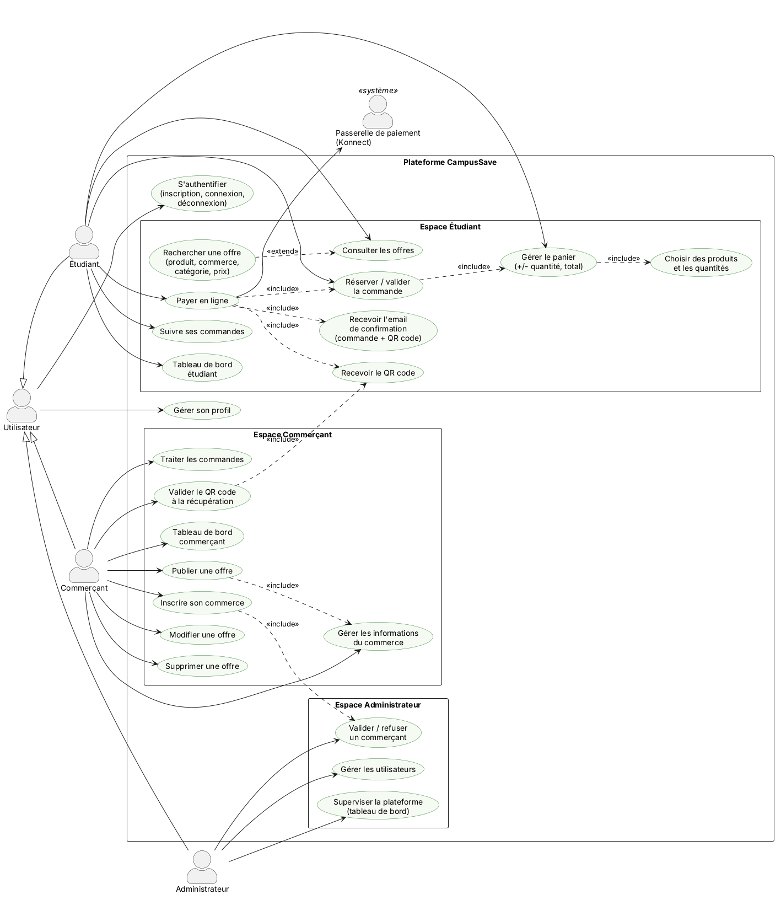

### 4.3 Diagramme de classes

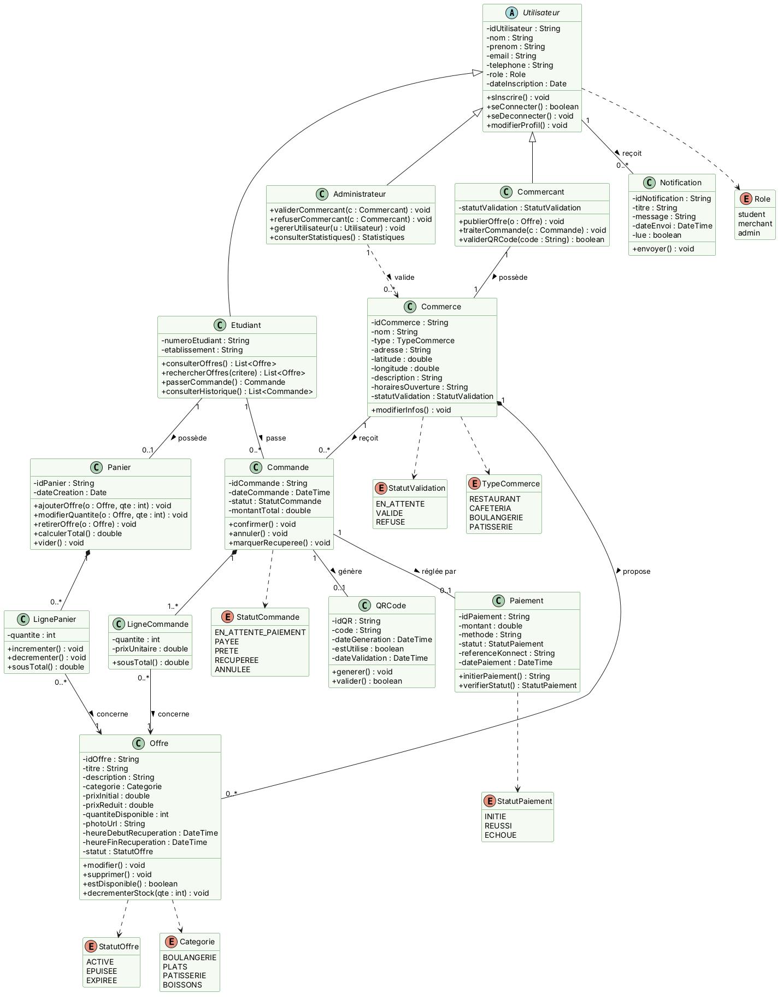

Les sources PlantUML (`docs/uml/*.puml`) ont été mises à jour pour correspondre exactement au code final : code de commande `CS-XXXXXX`, email de l'étudiant, prix en millimes, statut d'offre `RETIREE`, lien de paiement Konnect, EcoPoints et statistiques.

### 4.4 Modèle de données (Cloud Firestore)

| Collection | Contenu principal |
|---|---|
| `users` | nom, prénom, email, téléphone, rôle, établissement et numéro étudiant, EcoPoints, jeton de notification |
| `shops` | nom, type, adresse, coordonnées GPS, horaires, description, statut de validation, identifiant du commerçant |
| `offers` | titre, description, catégorie, prix initial et réduit, quantité disponible, photo, début et fin de retrait, statut |
| `orders` | code, étudiant, commerce, lignes (offre, quantité, prix unitaire), montant total, statut, paiement, QR code, dates |

Tous les montants sont stockés en **millimes** (entiers) pour éviter les erreurs d'arrondi : 4 500 millimes = 4,500 DT.

### 4.5 Cycle de vie d'une commande

```
EN_ATTENTE_PAIEMENT ──(paiement confirmé par Konnect)──► PAYEE ──(commerçant)──► PRETE ──(QR validé)──► RECUPEREE
        │
        └──(paiement refusé, ou 30 minutes sans paiement)──► ANNULEE  (le stock est rendu)
```

## 5. Backend : l'API REST commune

Le backend (`backend/`) est une API Node.js / Express 5 utilisant le SDK Firebase Admin. Il est organisé en `routes` (déclaration des URL et des règles de validation), `controllers` (logique métier), `middleware` (authentification, gestion des erreurs) et `services` (Konnect, email, notifications).

**Points importants de la réalisation :**

- **Rôles.** Le rôle est enregistré comme *custom claim* dans le jeton Firebase. Un middleware `requireRole` protège chaque route. Le rôle administrateur ne peut pas être choisi à l'inscription : il se crée uniquement par un script.

- **Prix calculés par le serveur.** Lors d'une commande, l'application envoie seulement les offres et les quantités ; le serveur relit les prix dans Firestore. Un utilisateur ne peut donc pas modifier le montant à payer.

- **Stock réservé dans une transaction.** La création de commande vérifie et décrémente le stock de chaque offre dans une transaction Firestore. Deux étudiants ne peuvent pas acheter la dernière portion en même temps.

- **Paiement vérifié auprès de Konnect.** Le webhook ne fait pas confiance aux paramètres reçus : il redemande le statut du paiement à Konnect avant de passer la commande en « Payée ». Ce n'est qu'à ce moment que le QR code est généré et que l'email de confirmation est envoyé (une seule fois).

- **Expiration.** Une commande non payée après 30 minutes est annulée et son stock est rendu.

- **Notifications.** Firebase Cloud Messaging prévient l'étudiant quand sa commande est prête, puis quand elle est remise.

- **Statistiques.** Trois routes (`/stats/student`, `/stats/merchant`, `/stats/admin`) calculent les chiffres des tableaux de bord. Les notions « du jour » et « du mois » sont calculées à l'heure de Tunis.

- **Erreurs homogènes.** Toutes les erreurs ont la forme `{ code, message }` avec un message en français, affiché tel quel par les applications.

- **Données de démonstration.** `npm run seed` crée cinq commerces réalistes autour de l'ESSECT, quinze offres et des comptes de test, sans toucher aux vraies données.

La liste complète des routes est donnée dans le `README.md`.

## 6. Application Web

L'application web (`web/`) est développée avec React 19, Vite et React Router. Elle contient trois espaces, un par rôle, et redirige automatiquement chaque utilisateur vers le sien après connexion.

### 6.1 Identité visuelle

Nous avons choisi une identité propre à CampusSave plutôt qu'un modèle générique :

- **Couleurs** : un vert pin profond pour la structure, un fond crème chaud et un rouge harissa réservé aux réductions et aux urgences (offre qui se termine dans moins d'une heure).

- **Typographies** : Newsreader (titres, à empattements) et Figtree (texte de l'interface), hébergées avec l'application.

- **Éléments signature** : le logo en forme d'assiette avec cloche, les vignettes en arche qui représentent chaque catégorie, et les offres présentées comme des **tickets** avec encoches et compte à rebours avant la fin du retrait.

- **Accessibilité** : contraste suffisant, focus clavier visible, libellés pour les lecteurs d'écran, animations réduites si l'utilisateur le demande, affichage adapté au mobile.

### 6.2 Connexion et inscription

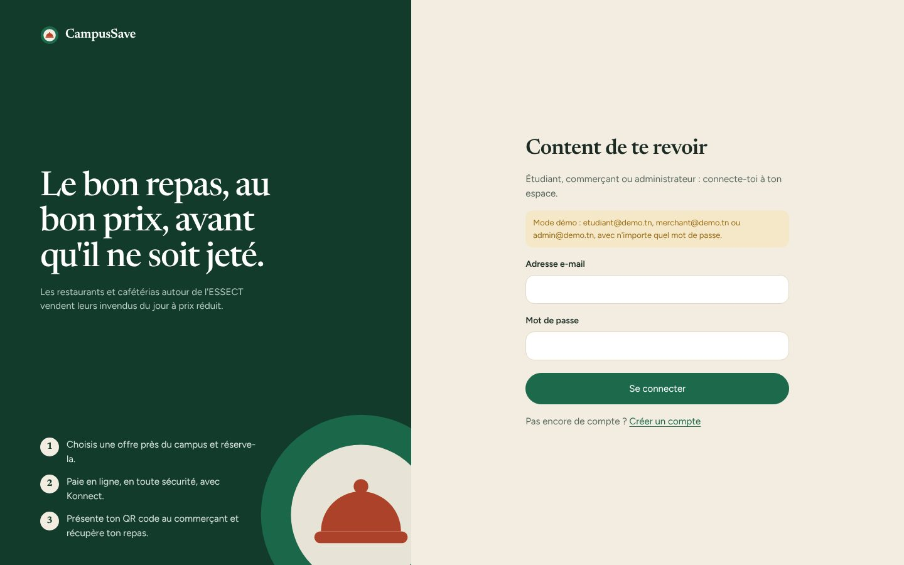

L'écran est partagé en deux : à gauche, la promesse du service et les trois étapes (réserver, payer, récupérer) ; à droite, le formulaire. L'inscription propose le choix du rôle étudiant ou commerçant.

### 6.3 Espace étudiant

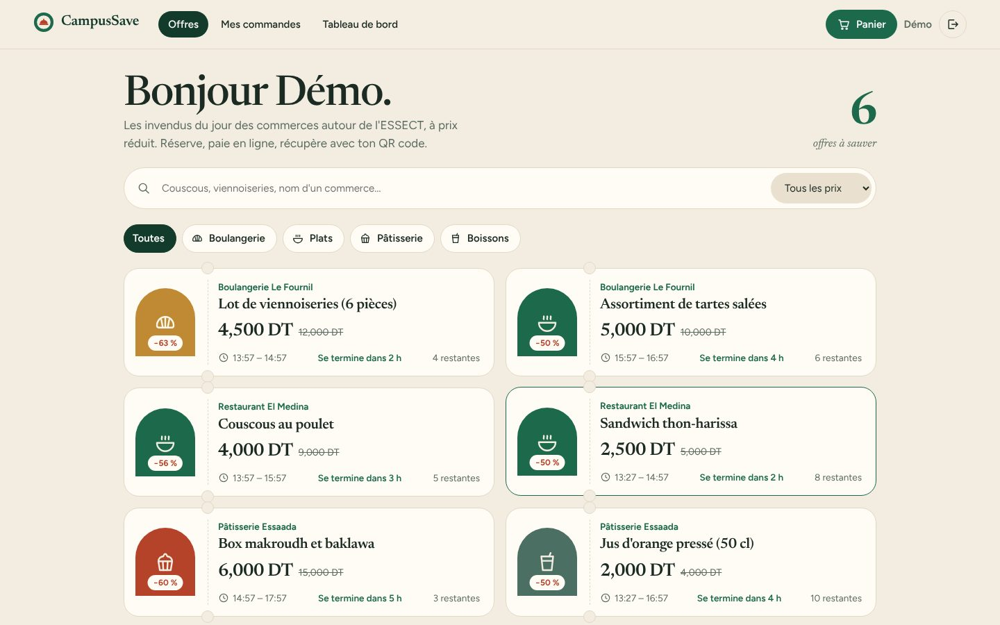

La page d'accueil salue l'étudiant, affiche le nombre d'offres disponibles, une barre de recherche (produit ou commerce), un filtre de prix et des catégories. Chaque offre indique le commerce, le prix réduit et le prix barré, le pourcentage de réduction, la plage de retrait, le temps restant et la quantité disponible.

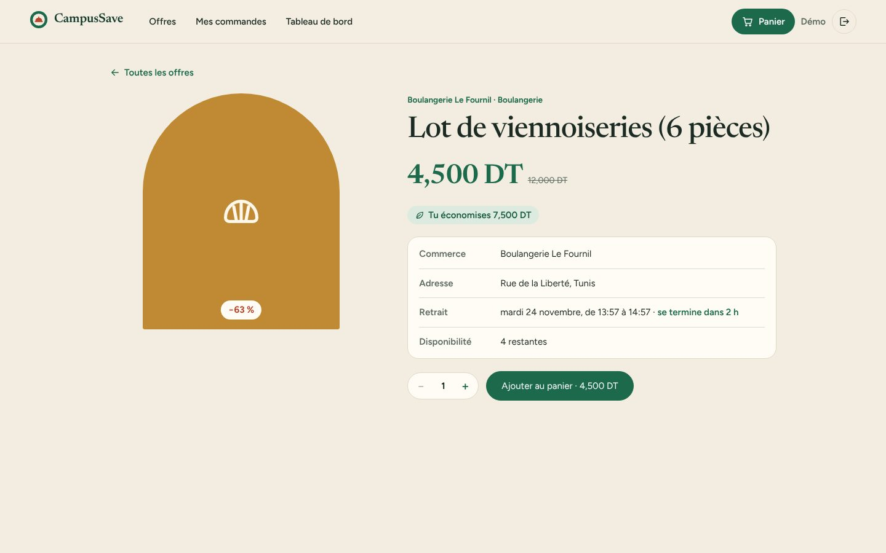

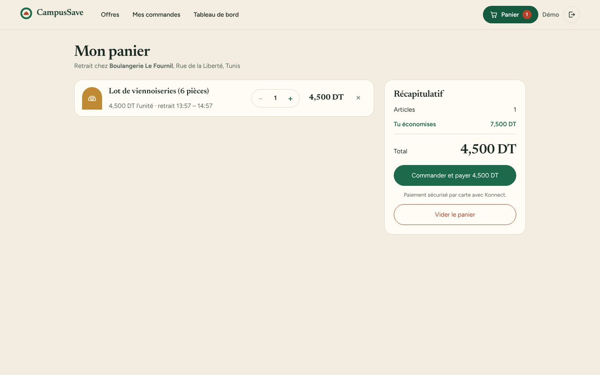

Le panier permet de modifier les quantités (dans la limite du stock), affiche l'économie réalisée et le total, puis lance le paiement.

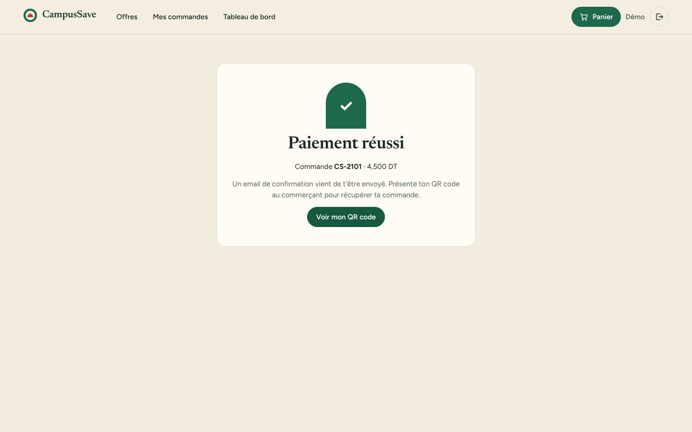

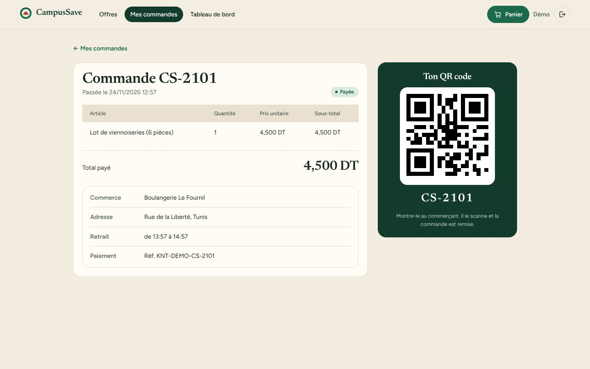

Après le paiement, l'étudiant reçoit un email de confirmation et retrouve sa commande avec son QR code, à présenter au commerçant.

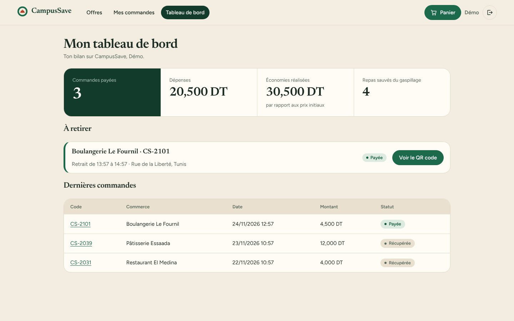

Le tableau de bord résume les commandes payées, les dépenses, les économies réalisées et les repas sauvés du gaspillage, et met en avant les commandes à retirer.

### 6.4 Espace commerçant

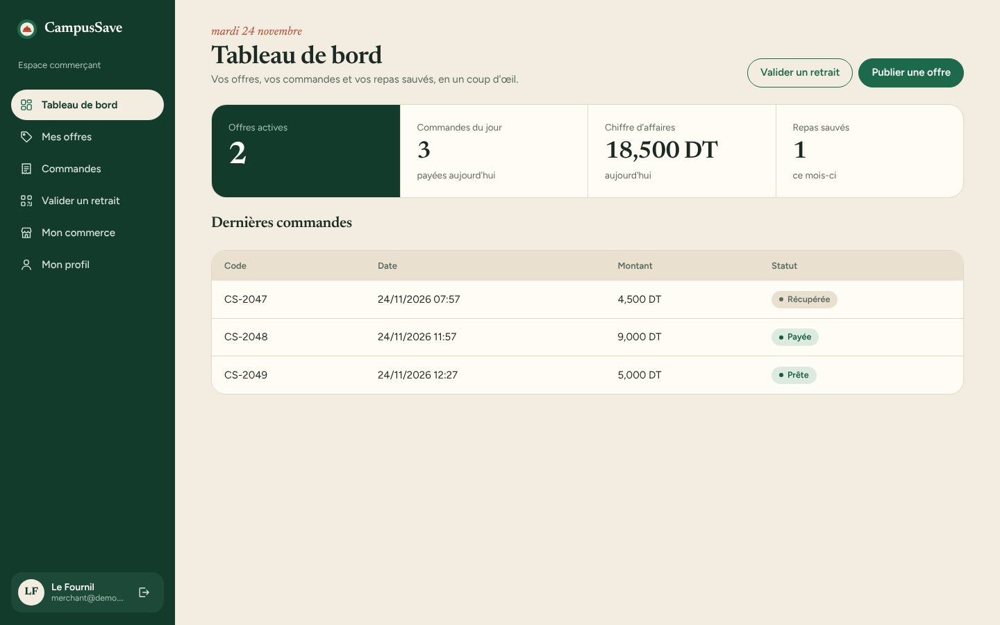

Le commerçant voit ses offres actives, les commandes et le chiffre d'affaires du jour, et les repas sauvés ce mois-ci. Deux actions rapides : publier une offre et valider un retrait.

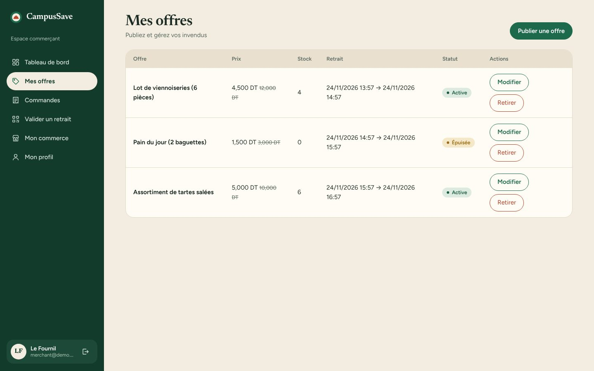

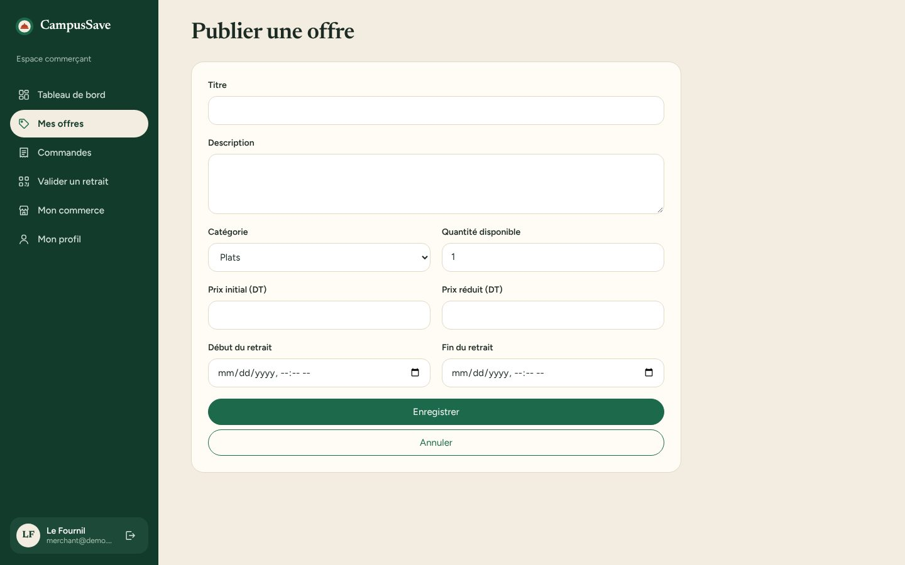


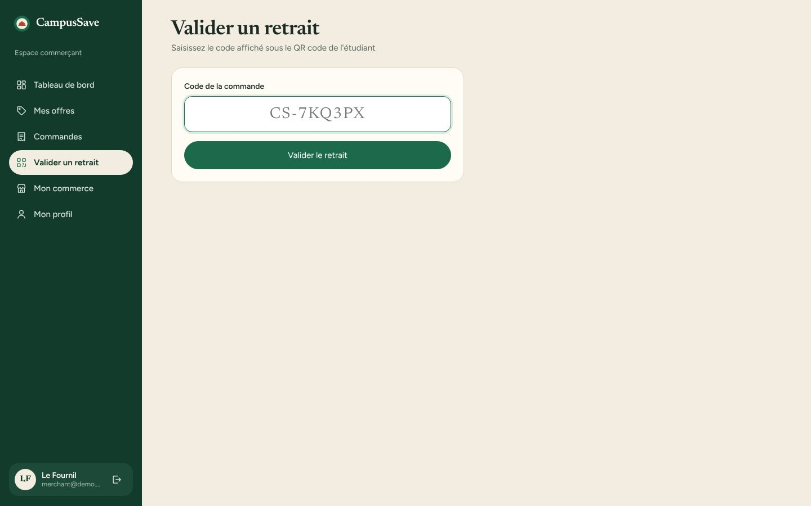

Au retrait, le commerçant saisit le code affiché sous le QR code (le scan par caméra est prévu dans l’application mobile). Le serveur refuse un code déjà utilisé ou une commande non payée.

### 6.5 Espace administrateur

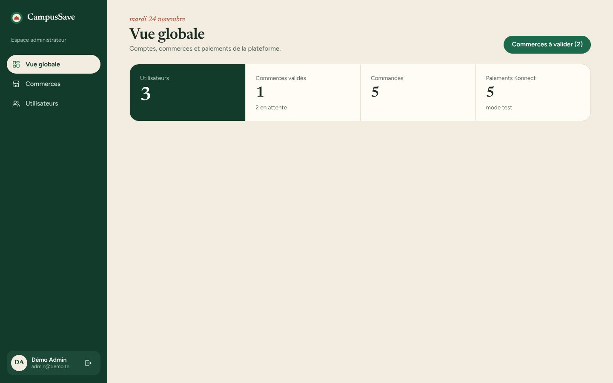

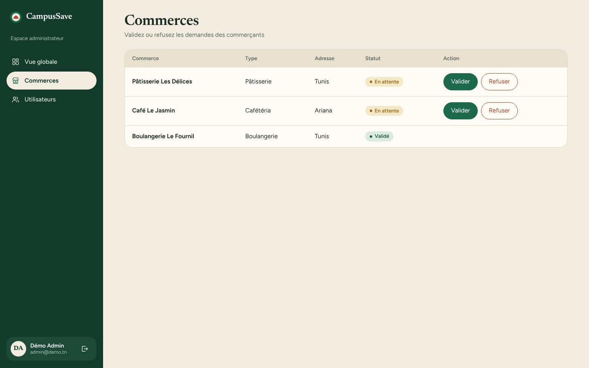

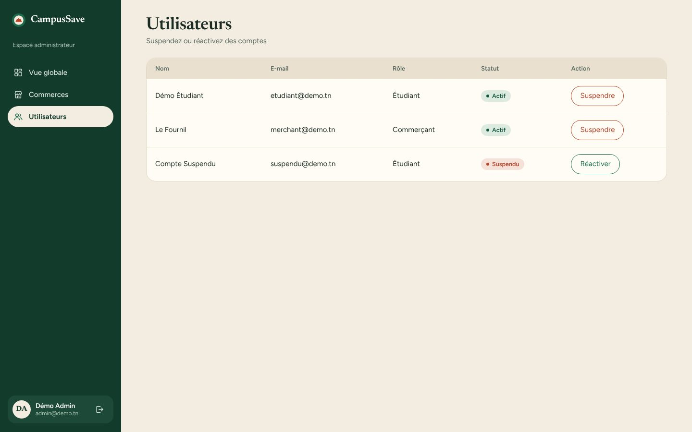

L'administrateur suit l'activité de la plateforme, valide ou refuse les nouveaux commerces et peut suspendre un compte (la suspension déconnecte immédiatement l'utilisateur).

### 6.6 Version mobile du site

| Offres | Détail |
|---|---|
| 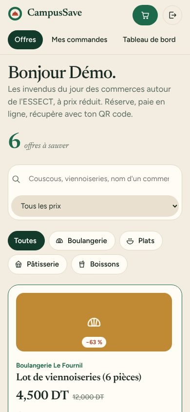 | 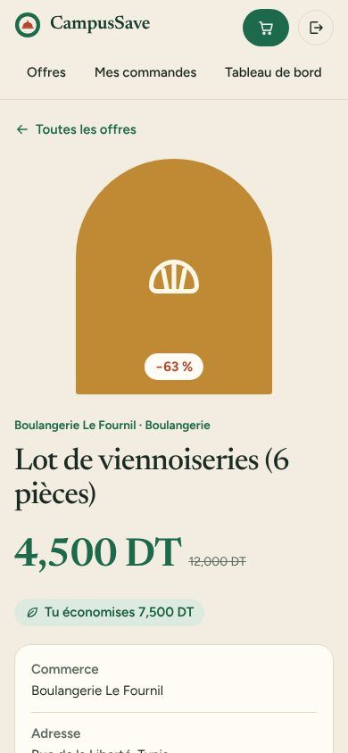 |

## 7. Application Mobile

L'application mobile Flutter (`mobile/`) utilise la même API et le même projet Firebase que le site web : un étudiant peut commander sur son téléphone et retrouver sa commande sur le web, et inversement.

**Paquets prévus :** `firebase_core`, `firebase_auth`, `firebase_messaging` (notifications), `http` (appels à l'API), `provider` (état de l'application), `webview_flutter` (page de paiement Konnect), `mobile_scanner` (scan du QR code par le commerçant), `qr_flutter` (affichage du QR code), `shared_preferences`.

**Écrans prévus :** connexion et inscription, liste et recherche des offres, détail d'une offre, panier, paiement (WebView Konnect), mes commandes avec QR code, tableau de bord ; côté commerçant, scan du QR code au retrait.

**État au moment du rendu :** la structure du projet est en place (`lib/models`, `lib/screens`, `lib/services`, `lib/widgets`). Le développement des écrans est en cours.

> *Section à compléter par Azer : captures d'écran de l'application, écrans réalisés, difficultés rencontrées.*

## 8. Sécurité

- **Firestore fermé** : les règles `firestore.rules` refusent tout accès direct depuis les applications. Tout passe par l'API, qui vérifie le jeton et le rôle.

- **Contrôle d'accès par rôle** sur chaque route, et vérification de propriété : un commerçant ne voit que les commandes de son commerce, un étudiant que les siennes.

- **Aucun montant venant du client** : prix et totaux sont recalculés par le serveur.

- **Paiement revérifié** auprès de Konnect avant toute confirmation.

- **QR code à usage unique** : une fois validé, il ne peut plus servir.

- **Secrets hors du dépôt** : `.env`, clé du compte de service Firebase, configuration web et fichiers Firebase mobile sont exclus par `.gitignore`.

- **Validation des entrées** avec express-validator (types, bornes, cohérence des prix et des horaires).

## 9. Tests et qualité

- **Tests automatisés du paiement** (`npm test` dans `backend/`) : 10 tests, tous réussis (paiement confirmé, refusé, webhook appelé deux fois, montant incohérent, etc.).

- **Tests de l'API de bout en bout** avec l'émulateur Firebase Authentication : 140 vérifications réussies sur l'authentification, les commerces, les offres, les commandes, les statistiques et le script de démonstration.

- **Tests manuels** de chaque route avec Thunder Client, puis du parcours complet avec les cartes de test Konnect (une carte acceptée, une carte refusée).

- **Application web** : compilation de production et analyse statique (oxlint) sans erreur ni avertissement ; chaque écran a été vérifié en navigateur, sur ordinateur et sur mobile, sans erreur dans la console.

## 10. Difficultés rencontrées

- **Évolution du SDK Firebase Admin** : la version 14 a supprimé l'ancienne API (`admin.apps`, `admin.firestore()`). Nous sommes passés à l'API modulaire.

- **Alignement des formats entre membres** : les commandes et le paiement ont été développés en parallèle avec des noms de champs différents. Nous avons fixé un format unique, aligné sur le diagramme de classes.

- **Adresse de l'API Konnect** : l'adresse de test officielle est `api.preprod.konnect.network`, différente de celle utilisée au départ.

- **Fusions concurrentes** : certaines fusions ont introduit des imports en double ; la relecture systématique des *pull requests* et les tests ont permis de les corriger avant le rendu.

## 11. Bilan et perspectives

Le backend et l'application web couvrent les huit fonctionnalités obligatoires et deux bonus (EcoPoints et indicateurs d'impact). Le parcours complet, de la publication d'une offre au retrait avec QR code, fonctionne avec un vrai paiement en mode test.

**Pistes d'amélioration :**

- Finaliser l'application mobile et y ajouter le scan du QR code pour les commerçants.

- **Campus Radar** : carte des commerces proches, à partir des coordonnées GPS déjà enregistrées.

- **Panier surprise** : un lot d'invendus variés à prix fixe.

- Envoi des photos d'offres vers Firebase Storage plutôt que par lien.

- Passage de Konnect en production après validation du compte marchand.
